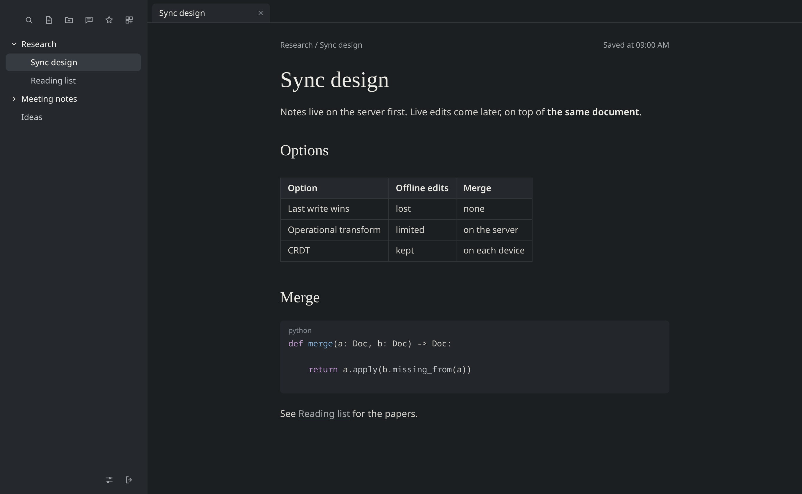
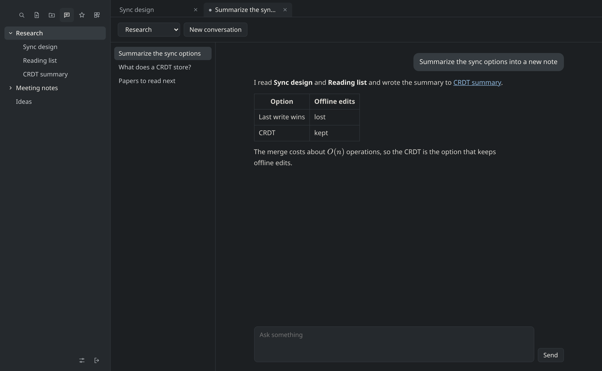
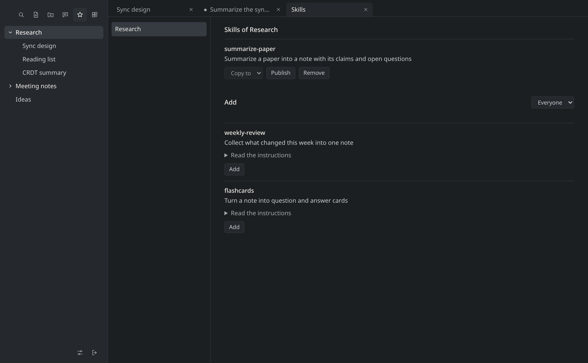
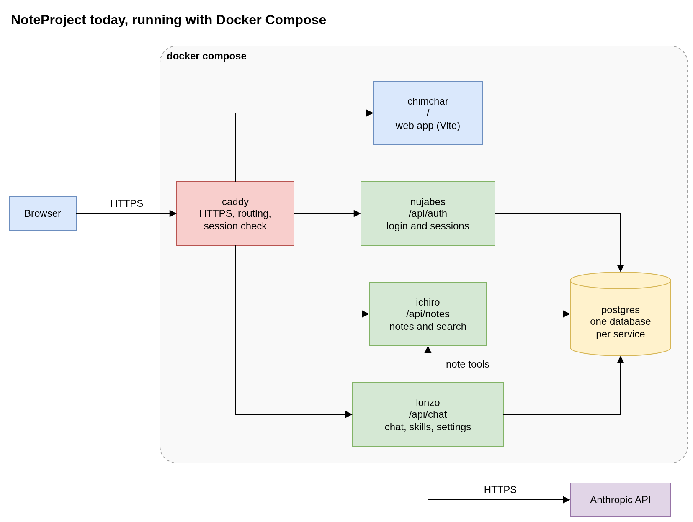
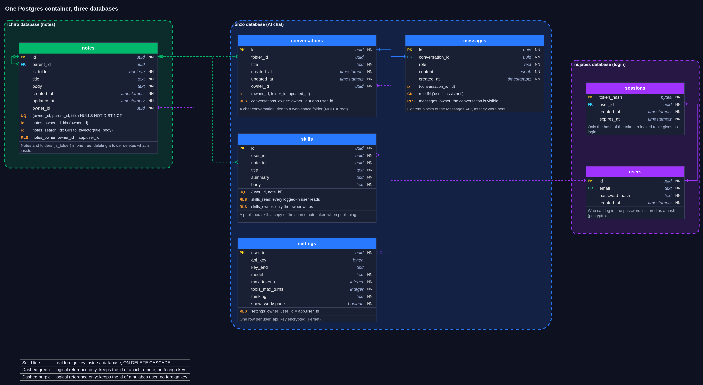

# NoteProject

A self-hosted notes app with an AI chat that reads and writes your notes. You write Markdown in the browser, keep it in folders on your own server, and ask the chat to find, summarize or create notes for you.

It is a personal project, built to be used every day and to learn systems engineering: servers, authentication, infrastructure and, later, live sync.

**Status:** it runs on one machine with Docker Compose. Deploying to AWS, live edits, a desktop app and a mobile app are planned ([milestones](https://github.com/LuccaRh/NoteProject/milestones)).

## The app

The screenshots use sample notes.

The editor renders Markdown as you type and shows the raw marks only on the line with the cursor.



The chat answers next to your notes. Here it created a note, which appeared in the tree when the answer ended.



The Skills tab lists the skills of each workspace and the ones other people published.



## Infrastructure

The drawing shows what is built today. Each service runs in its own container, and the only way in is Caddy.



| Service | Stack | What it does |
|---|---|---|
| `caddy` | Caddy | Serves HTTPS and sends each path to its service. Before notes and chat, it asks `nujabes` who owns the session cookie. |
| `chimchar` | Vite, TypeScript, CodeMirror 6 | The web app: tree, editor, tabs, chat, skills and settings. |
| `nujabes` | FastAPI | Login, logout and sessions. |
| `ichiro` | FastAPI | Notes and folders, full-text search and title search. |
| `lonzo` | FastAPI, Anthropic SDK | The chat: it talks to the model, runs its note tools through `ichiro`, and keeps conversations, skills and settings. |
| `postgres` | Postgres 18 | One container with one database per service. |

GitHub Actions runs the checks of each service on every pull request and on pushes to `master`.

## Databases

Each service owns its database, so a reference from one to another is only an id, with no foreign key. Row-level security in Postgres keeps each person to their own rows, using the user id that Caddy passes on from `nujabes`.



| Database | Table | What it keeps |
|---|---|---|
| `ichiro` | `notes` | Notes and folders in one tree, with a search index on title and body. |
| `lonzo` | `conversations` | One row per chat, tied to a folder. |
| `lonzo` | `messages` | What the person and the model said, in order, including tool calls. |
| `lonzo` | `skills` | Published skills: a copy of the note taken when publishing. |
| `lonzo` | `settings` | One row per person: Anthropic key (encrypted), model and limits. |
| `nujabes` | `users` | Email and password hash. |
| `nujabes` | `sessions` | Open logins; only the hash of the token is stored. |

Each database also has Alembic's `alembic_version` table, which records the last migration applied.

## Features

**Notes**

- Folders, tabs and autosave.
- Live Markdown preview: headings, tables and code blocks with colors.
- Search by words or title with `Ctrl+O`.
- Links between notes: type `[[` and pick a note.

**Chat**

- Answers arrive as they are written, with Markdown and LaTeX, and a button to cancel.
- A status line shows what the AI is doing.
- Conversations stay on the server, listed by folder.
- Each person brings their own Anthropic key and chooses the model and limits in the settings.

**Workspaces**

A workspace is a folder that has a `.workspace/` folder inside, which is hidden from the tree by default. It gives the AI the context of one subject across conversations. You create one by describing what you want, and the AI writes it:

- `.workspace/CLAUDE.md`: the goal and how to answer, sent with every question asked in that folder.
- `.workspace/kb/`: background notes the AI reads when it needs them.
- `.workspace/skills/`: skills.

**Skills**

A skill is a note with instructions for one task, kept in `.workspace/skills/`. The list of skills goes with each question, and the AI reads a skill when the question fits it. You can also call one by typing `/` and its name in the chat.

In the Skills tab you can copy a skill to another workspace, publish it, or add a skill someone else published. Publishing and adding both make copies, so later edits to one copy do not reach the others.

## How they work together

The chat works on your notes through tools, so it can change them as well as talk about them:

| Tool | What it does |
|---|---|
| `search_notes`, `search_titles` | Find notes by words or by title. |
| `list_folder`, `read_note` | Browse folders and read a note. |
| `create_note`, `create_folder` | Write new notes and folders at a path. |
| `edit_note`, `delete_note` | Change or remove a note. |

The tools reach any of your folders, not only the current one. When the AI writes, the tree and the open note reload at the end of the answer.

For example, with a `Research` folder:

1. You create a workspace from `Research`, describing the subject and how you want answers.
2. You ask the chat in that folder to summarize your notes. The workspace rules go with the question.
3. The AI searches, reads the notes, and creates a summary note, with a link you can click to open it.
4. A task you repeat becomes a skill. You run it with `/summarize-paper`, or publish it for other people.

## Run

Docker Compose starts everything. It needs the `.env` below. `make check` also needs [uv](https://docs.astral.sh/uv/).

| What | Start | Open in the browser |
|---|---|---|
| everything | `docker compose -f docker-compose-dev.yml up --build` | <https://notes.localhost> |
| editor only, no API | `make install` once, then `make dev` | <http://localhost:5173> |

Caddy (`caddy/Caddyfile`) gives each API prefix to its own service, without the `/api` prefix; any other `/api` path is a 404, and everything else goes to the Vite dev server. Both reload when a file is saved. The services publish no port of their own; Postgres listens on `localhost:5432` for the tests. `*.localhost` names resolve to the machine itself.

### Trusting the local certificate

Caddy signs the certificate for `notes.localhost` with its own local CA, kept in the
`caddy_data` volume. Until the system trusts that CA, the browser shows a warning. Copy the
root certificate out of the container and add it once (Arch Linux):

```sh
docker compose -f docker-compose-dev.yml cp \
    caddy:/data/caddy/pki/authorities/local/root.crt caddy-root.crt
sudo trust anchor caddy-root.crt
```

Firefox keeps its own list: import the same file under Settings, Certificates. Deleting the
`caddy_data` volume creates a new CA, which has to be trusted again.

### Environment variables

Passwords and connection settings live in a `.env` file at the repo root. Git ignores it, so
each clone creates its own:

```sh
cp .env.example .env    # then replace every value
```

`.env.example` lists the variables the project uses, each with a comment and a placeholder
value. Docker Compose loads `.env` into the `postgres` container (`env_file` in
`docker-compose-dev.yml`); each service gets only its own variables (`environment`):

| Variable | Read by | Meaning |
|---|---|---|
| `POSTGRES_USER`, `POSTGRES_PASSWORD`, `POSTGRES_DB` | `postgres` image | superuser, its password and the database it connects to |
| `ICHIRO_DB_PASSWORD`, `ICHIRO_MIGRATOR_PASSWORD` | `postgres/init` | passwords of the `ichiro` and `ichiro_migrator` users |
| `ICHIRO_DATABASE_URL` | notes API | `postgresql+psycopg://ichiro:<password>@postgres:5432/ichiro` |
| `ICHIRO_MIGRATION_URL` | notes Alembic | the same database, as `ichiro_migrator`, which owns the tables |
| `LONZO_*`, `NUJABES_*` | `lonzo`, `nujabes`, `postgres/init` | the same four variables for each service |
| `LONZO_SECRET_KEY` | chat service | encrypts the Anthropic key each user saves in the settings; make it with `Fernet.generate_key()` from `cryptography` |

The host in these URLs is `postgres`, the service name in the compose file, which only
resolves inside the containers. `make check` runs the tests on the host, so it swaps the host
for `localhost`. The `postgres` image reads its three variables only when the `db` volume is
empty; after changing them, recreate the volume with
`docker compose -f docker-compose-dev.yml down -v` (this deletes the data).

### Database migrations

Each service has its own Alembic migrations (`apps/<service>/migrations/versions/`). On a fresh database, and after pulling a new migration, apply them inside each container:

```sh
for service in ichiro lonzo nujabes; do
    docker compose -f docker-compose-dev.yml exec $service \
        uv run alembic upgrade head
done
```

### Creating a user

There is no sign-up page yet: a user is a row in the `nujabes` database.

```sh
docker compose -f docker-compose-dev.yml exec postgres \
    sh -c 'psql -U "$POSTGRES_USER" -d nujabes'
```

```sql
INSERT INTO users (email, password_hash)
VALUES ('me@example.com', crypt('password', gen_salt('bf')));
```

The chat also needs an Anthropic API key, which each person saves in the app's settings.

### Trying an API in the browser

Every FastAPI service serves its own interactive docs at `/docs` (Swagger UI), built from the
code:

1. Open the service's `/docs` (for now only with a published port: through Caddy the page
   asks for `/openapi.json` without the `/api` prefix); it lists every route.
2. Click a route, then **Try it out** and **Execute**.
3. The page shows the request it sent (as a `curl` command), the status code and the body.

A `GET` route can also be opened straight in the address bar, e.g.
<https://notes.localhost/api/notes> lists the notes.

## Check

```bash
make check     # chimchar: tsc + vite build; ichiro, lonzo, nujabes: ruff, mypy, pytest
```

The server tests talk to the real database: start Postgres first (`docker compose -f docker-compose-dev.yml up -d postgres`).

## Development workspace

The repo has a workspace for coding sessions with Claude Code. Open the session at the root; `CLAUDE.md` explains the principles. First time in a clone: `ai/tools/instalar.sh`.

- `ai/kb/areas.yaml`: closed vocabulary of areas; `ai/np contexto <area>` lists only what to read.
- `ai/kb/escopos/<branch>.md`: request, context and what is out of scope for each branch.
- `ai/kb/libs/`: API cards for the libraries, with the installed version (lint warns when it changes).
- `ai/kb/diagramas/`: diagram sources in YAML (`diagrama.py` makes the `.drawio` and `.drawio.svg`).
- `ai/obsidian/`: copy of the `Note Project/` vault, kept in sync by `obsidian_sync.py`.

| Command | For |
|---|---|
| `ai/np status` / `contexto <area>` / `areas` | branch state / what to read / the vocabulary |
| `ai/np obsidian` / `duvidas` / `diagrama <spec>` | vault sync / note markers / diagrams |
| `ai/np lint` / `test` / `check` | workspace rules / `ai/tools/` tests / `make check` |

Skills: `/tarefa`, `/aprender`, `/nota`, `/diagrama`, `/duvida`, `/destrinchar`, `/commit`, `/escrita`, `/lacunas`. Agent: `leitor`. Tools in `ai/tools/`: `np.py`, `obsidian_sync.py`, `hooks_contexto.py`, `diagrama.py`, `commit_msg.py`, `estilo.py`.
