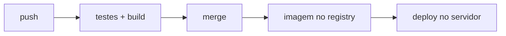

# CI e CD

Todo commit pode quebrar algo, e todo deploy feito à mão pode esquecer um passo.

- **CI** (integração contínua): a cada push, um robô roda testes e build. O commit que quebra fica vermelho antes do merge.
- **CD** (entrega contínua): depois do merge, o robô gera a imagem e põe no ar. Sem CD configurado, o merge só junta o código na branch principal: nada vai ao ar.
- **GitHub Actions**: o robô do GitHub; cada workflow é um YAML em `.github/workflows/`.
- **GHCR**: o registry de imagens do GitHub (`ghcr.io/...`); o servidor baixa a imagem pronta de lá.

- Para o deploy entrar na nuvem sem chave guardada: [[OIDC]].

> [!example] No NoteProject
> O CI roda, a cada push, os mesmos checks do `make check` (um job por serviço); o deploy por merge é plano ([[Infra — deploy e operação]]).

Docs: [GitHub Actions](https://docs.github.com/en/actions),
[GHCR](https://docs.github.com/en/packages/working-with-a-github-packages-registry/working-with-the-container-registry).
