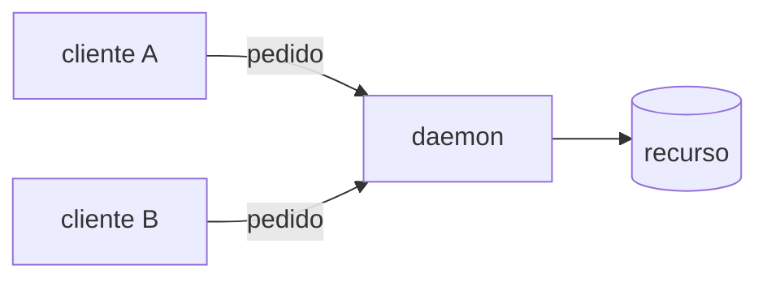

# Daemon

Alguns programas precisam estar sempre prontos para atender outros: guardar um arquivo, aceitar conexões, rodar uma tarefa na hora marcada. Abrir e fechar um programa a cada pedido não serve.

- **Daemon**: programa que fica rodando em segundo plano, sem janela, esperando pedidos.
- O `d` no fim do nome é convenção do Unix: `sshd` (SSH), `httpd` (HTTP), `systemd`.
- Quem fala com ele é outro programa, por socket, HTTP ou outro canal; quase nunca uma pessoa.

## Um dono só para um recurso

Um uso comum é deixar o daemon como **único dono** de um recurso (um arquivo, um banco, um dispositivo). Os outros programas pedem a ele em vez de abrir o recurso direto.

| Cada cliente abre o recurso | Um daemon dono |
|---|---|
| cada cliente reimplementa as regras | regra escrita uma vez, no daemon |
| cliente que não abre o recurso (um navegador) fica de fora | basta o cliente falar o protocolo |
| dois processos escrevendo ao mesmo tempo → travas | uma fila de escrita só |
| trocar o recurso mexe em todos os clientes | trocar o recurso mexe só no daemon |

- O custo: o daemon precisa estar rodando; se ele cai, nenhum cliente acessa o recurso.

> [!example] No NoteProject
> No app desktop, o [[O daemon notesd|notesd]] vai ser o dono do banco de notas no dispositivo; editor e IA pedem a ele.

Doc: [daemon(7) — systemd](https://man7.org/linux/man-pages/man7/daemon.7.html).
