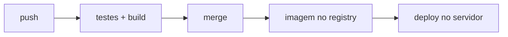

# CD

Todo deploy feito à mão pode esquecer um passo. Depois que o [[CI]] aprova e o código entra na branch principal, o mesmo robô pode pôr a versão nova no ar.

- **CD** (entrega contínua): depois do merge, o robô gera a imagem e põe no ar. Sem CD configurado, o merge só junta o código na branch principal: nada vai ao ar.
- **GHCR**: o registry de imagens do GitHub (`ghcr.io/...`); o servidor baixa a imagem pronta de lá.
- Para o deploy entrar na nuvem sem chave guardada: [[OIDC]].

> [!example] No NoteProject
> O deploy por merge é plano ([[Infra — deploy e operação]]).

Doc: [GHCR](https://docs.github.com/en/packages/working-with-a-github-packages-registry/working-with-the-container-registry).
