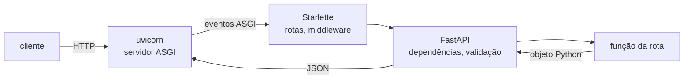

# FastAPI

Uma API HTTP em Python precisa de várias peças além da regra de negócio: um programa que escuta a porta e entende HTTP, um roteador que leva `GET /notes/42` à função certa, código que lê o JSON do corpo, confere tipos e devolve 422 quando vem errado, e documentação da API que não envelheça. Escrever isso à mão em cada serviço repete código e deixa a validação e a documentação divergirem do código.

FastAPI é um framework web que monta essas peças a partir das **type hints** da função: o tipo de cada parâmetro diz de onde ele vem (caminho, query, corpo), como validar e como aparece na documentação OpenAPI, gerada sozinha em `/docs`.

## De onde vem: WSGI e ASGI

|                        | WSGI                                                            | ASGI                                                                |
| ---------------------- | --------------------------------------------------------------- | ------------------------------------------------------------------- |
| Ano                    | 2003 (PEP 333)                                                  | 2016–2019 *(geral)*                                                 |
| Modelo                 | uma chamada síncrona por pedido: entra o pedido, sai a resposta | função `async` que recebe e manda **eventos**; a conexão pode durar |
| Pedidos ao mesmo tempo | uma thread ou processo por pedido                               | muitos num processo só, no event loop (`asyncio`)                   |
| [[WebSocket]]          | não cabe no modelo                                              | nativo                                                              |
| Frameworks             | Flask, Django (clássico)                                        | Starlette, FastAPI, Django (modo async)                             |
| Servidor               | gunicorn, uWSGI                                                 | uvicorn, hypercorn                                                  |

Flask e Django nasceram no WSGI: cada pedido ocupa uma thread enquanto espera o banco ou a rede. ASGI troca isso por `async`/`await`: enquanto um pedido espera o [[Postgres]], o mesmo processo atende outro. FastAPI (2018) é uma camada sobre o **Starlette**, um framework ASGI pequeno, e usa o **Pydantic** para validar e serializar.

ASGI (Asynchronous Server Gateway Interface) é o combinado entre o servidor e a app: a app é uma função `async` que o servidor chama a cada pedido.

```python
async def app(scope, receive, send):
    # scope = o pedido já lido: {"method": "GET", "path": "/notes/7", ...}
    await send({"type": "http.response.start", "status": 200, ...})
    await send({"type": "http.response.body", "body": b'{"id": 7}'})
```

- O `FastAPI()` é um objeto que segue esse formato; qualquer servidor ASGI (uvicorn, Hypercorn, Granian, Daphne) consegue rodá-lo sem mudar a app.
- Servidor e app ficam **no mesmo processo Python**: a conversa entre eles é uma chamada de função, sem rede. O [[TCP]] só existe entre o cliente e o servidor.
- O servidor não conhece as rotas: entrega o caminho como texto (`"/notes/7"`). Achar a rota e converter o `"7"` em `int` é trabalho da app.

## As camadas de um pedido



1. **uvicorn** escuta a porta, lê os bytes HTTP e chama a app no formato ASGI. Sem ele a app é só um objeto Python; quem abre a porta é o servidor.
2. **Starlette** passa pelos middlewares (CORS, compressão) e acha a rota pelo método e caminho.
3. **FastAPI** resolve as dependências (`Depends`), lê caminho, query e corpo, e valida cada um contra a type hint. Erro de tipo vira **422** com a lista dos campos errados, sem a função rodar.
4. A **função da rota** recebe os valores já convertidos (`note_id: int` chega como `int`) e devolve um objeto Python: `dict`, modelo Pydantic, lista.
5. FastAPI converte o retorno em JSON, filtrando pelo `response_model` quando há um, e o uvicorn manda a resposta.

![[caminho-de-um-pedido.drawio.svg]]
*Um `curl` até a resposta: o TCP só aparece entre processos (host ⇄ container, API ⇄ Postgres); entre uvicorn e FastAPI é uma chamada de função (ASGI).*

## As peças

| Peça                 | O que faz                                                                                | Exemplo                                             |
| -------------------- | ---------------------------------------------------------------------------------------- | --------------------------------------------------- |
| `FastAPI()`          | o objeto da app: guarda rotas, middlewares e o ciclo de vida                             | `app = FastAPI()`                                   |
| rota                 | [[Decorator\|decorator]] que liga método + caminho a uma função                                         | `@app.get("/health")`                               |
| parâmetro de caminho | nome que aparece no caminho                                                              | `def get(note_id: int)` em `/notes/{note_id}`       |
| parâmetro de query   | nome que não está no caminho, tipo simples                                               | `def search(q: str, limit: int = 20)`               |
| corpo                | parâmetro do tipo de um modelo Pydantic                                                  | `def create(note: NoteIn)`                          |
| `response_model`     | o formato da resposta: valida e **corta** campos a mais                                  | `@app.get(..., response_model=NoteOut)`             |
| `Depends`            | função que roda antes da rota e entrega um valor a ela: conexão do banco, usuário logado | `def get(db = Depends(get_db))`                     |
| `APIRouter`          | grupo de rotas num arquivo à parte, incluído na app                                      | `app.include_router(notes.router, prefix="/notes")` |
| `lifespan`           | código que roda uma vez ao subir e ao descer o processo: abrir e fechar o pool do banco  | `FastAPI(lifespan=lifespan)`                        |
| `TestClient`         | chama a app em memória, sem uvicorn nem porta, para testes com pytest                    | `TestClient(app).get("/health")`                    |

- `Depends` é o que mais muda o desenho de um serviço: autenticação, sessão do banco e paginação viram dependências, e o teste troca uma dependência por outra (`app.dependency_overrides`) sem mexer na rota.
- O `TestClient` usa o `httpx` e fala ASGI direto com a app: o teste exercita roteamento, validação e serialização inteiros, sem subir servidor.
- O `@app.get(...)` registra a rota **ao importar o arquivo**, uma vez; a cada pedido só o corpo da função roda ([[Decorator#Decorator com argumento: a fábrica|a fábrica de decorator]]). Arquivo de rotas sem `include_router` não entra na lista: o pedido recebe 404.

## De onde vem cada parâmetro

A função da rota só declara nomes e tipos; quem decide se o valor sai do caminho, da query, do corpo ou de uma dependência é o FastAPI, olhando a assinatura **uma vez, ao registrar a rota** (no import do arquivo). A cada pedido ele só segue o que decidiu.

Primeiro, lê os nomes do caminho: `"/notes/{note_id}"` passa por uma regex que pega o que está entre chaves e guarda `{"note_id"}`. Depois, para cada parâmetro da função, a primeira regra que vale ganha:

| Ordem | Regra | De onde vem | Exemplo |
|---|---|---|---|
| 1 | tem `Depends(...)` (direto ou no `Annotated`) | roda a função e entrega o resultado | `conn: Annotated[Connection, Depends(get_conn)]` |
| 2 | o nome está entre as chaves do caminho | caminho | `note_id: UUID` em `/notes/{note_id}` |
| 3 | o tipo não é simples (modelo Pydantic, lista de modelos) | corpo JSON | `note: NoteCreate` |
| 4 | tipo simples (`str`, `int`, `UUID`, `bool`, …) | query string | `parent_id: UUID \| None = None` → `?parent_id=...` |

- Marcar à mão (`Query()`, `Path()`, `Body()`, `Header()`) passa por cima das regras 2–4: `Body()` num `int` faz o valor vir do corpo.
- Parâmetro de caminho não aceita valor padrão: o caminho só casa se o pedaço existe, então ele está sempre lá.
- Tipo `Request` ou `Response` não vem do pedido como dado: o FastAPI entrega o próprio objeto.

Depois de achar o valor, a **type hint** converte e valida. Na URL tudo é texto: `"01a1787d-..."` vira `UUID`, `"7"` vira `int`. O que não converte vira **422** com o campo e o motivo, sem a função rodar. Valor padrão (`= None`, `= ""`) torna o parâmetro opcional; sem padrão, faltar também é 422.

Fonte: FastAPI 0.150.0, `fastapi/utils.py` (`get_path_param_names`) e `fastapi/dependencies/utils.py` (`get_dependant`, `analyze_param`).

> [!example] Uso
> As rotas de notas usam as quatro regras numa função só, como em `update_note(conn, note_id, patch)`: [[API de notas#Pastas dentro de `src/notes`|API de notas]].

## Corpo com Pydantic

O corpo de um `POST` ou `PUT` é um JSON. Uma classe que herda de `BaseModel` descreve o formato dele, e um parâmetro com esse tipo diz ao FastAPI que o valor vem do corpo:

```python
from pydantic import BaseModel

class NoteIn(BaseModel):
    title: str              # obrigatório: sem valor padrão
    content: str = ""       # opcional: falta no JSON → ""

@app.post("/notes")
def create(note: NoteIn):   # note.title, note.content
    ...
```

| Corpo mandado | `content: str` | `content: str = ""` |
|---|---|---|
| `{"title": "Ideias", "content": "x"}` | roda, `content = "x"` | roda, `content = "x"` |
| `{"title": "Ideias"}` | **422**, a função não roda | roda, `content = ""` |
| `{"title": 5}` | 422 (`title` não é texto) | 422 |

O 422 sai antes da função: o FastAPI confere o JSON contra a classe e devolve a lista dos campos errados. Erro **dentro** da função vira 500.

## `Depends` com `yield`

```python
def get_conn():
    with engine.begin() as conn:
        yield conn

@app.get("/health")
def health(conn: Annotated[Connection, Depends(get_conn)]):
    conn.execute(text("SELECT 1"))
```

| Parte | Quem lê | O que diz |
|---|---|---|
| `conn` | ninguém em especial | nome livre; `db` funcionaria igual |
| `Connection` | o mypy e quem lê o código | a type hint: o que chega |
| `Annotated[..., ...]` | Python | o tipo, mais uma etiqueta para o framework |
| `Depends(get_conn)` | FastAPI | não procurar no pedido: rodar `get_conn` e usar o que ele der |

A cada pedido, o FastAPI trata a dependência como um [[Context manager|context manager]]:

1. roda `get_conn` até o `yield`: pega uma conexão do pool e abre a transação;
2. chama a rota com `conn` = o valor do `yield`;
3. a rota terminou: continua `get_conn` depois do `yield`, e o `with` faz `COMMIT` ou `ROLLBACK` e devolve a conexão ([[Transação|transação]]).

A rota nunca abre nem fecha a conexão; trocar `get_conn` por outra função no teste (`app.dependency_overrides`) não mexe na rota.

## Muitos clientes ao mesmo tempo

Exemplo: uma rota que gasta 2 ms de CPU e espera 50 ms o banco, com 200 clientes chamando juntos.

![[fastapi-django-concorrencia.drawio.svg]]
*Em cima, cada worker WSGI segura um pedido enquanto espera o banco; embaixo, o event loop solta o pedido a cada `await` e segue com o próximo.*

- **Django clássico** (gunicorn, 4 workers síncronos): um pedido por worker. Capacidade ≈ 4 ÷ 0,052 s ≈ 77 pedidos/s; o resto espera na fila, e o tempo de resposta cresce com ela. Atender mais pede mais processos ou threads, cada um com a memória da app.
- **FastAPI** (uvicorn, `async def`, driver async): no `await` da consulta o processo deixa o pedido A e atende o B, o C… Os 200 ficam em andamento num processo só; o limite passa a ser o pool de conexões do banco e a CPU (2 ms por pedido ≈ 500 pedidos/s por processo).
- O ganho vale só para **espera de I/O feita com `await`**. Uma rota com 50 ms de CPU ocupa o loop e todos esperam; aí a saída é mais processos, como no Django.

| | Django clássico | FastAPI com `async` |
|---|---|---|
| Pedidos esperando I/O juntos | workers × threads | centenas por processo |
| Custo de um a mais | processo ou thread | uma corrotina (KB) |
| Rota pesada de CPU | ocupa um worker | trava o processo inteiro |
| Escala por | mais workers | mais processos, quando a CPU enche |

O Django atual também roda em ASGI com views `async`, mas boa parte do ORM ainda é síncrona *(geral)*; a comparação vale para o modelo clássico.

## `async def` ou `def`

Cada rota (e cada dependência) escolhe; a mesma app mistura as duas.

![[fastapi-async-sync.drawio.svg]]
*`async def` roda no próprio loop; `def` vai para uma thread do pool, e o loop segue atendendo enquanto ela bloqueia.*

| A rota é | FastAPI roda | Serve para |
|---|---|---|
| `async def` | no event loop, direto | chamadas com `await`: driver async do banco, `httpx.AsyncClient` |
| `def` | numa thread do pool (40 por padrão, do anyio *(geral)*), para não travar o loop | código síncrono: driver sem async, leitura de arquivo, CPU leve |

- Rotas `def` se comportam como um servidor WSGI com threads: até 40 esperas juntas por processo.
- Dentro de `async def`, uma chamada que bloqueia (`time.sleep`, `requests.get`, driver síncrono) **para o processo inteiro**: nenhum outro pedido anda até ela voltar. Na dúvida, `def` é o mais seguro.

## Rodar

| Comando | Para | Escuta em |
|---|---|---|
| `fastapi dev main.py` | desenvolvimento: recarrega ao salvar | `127.0.0.1:8000` (só a própria máquina) |
| `fastapi run main.py` | produção, sem reload | `0.0.0.0:8000` (qualquer interface) |
| `uvicorn main:app --host … --port …` | o mesmo, chamando o servidor direto | o que for passado |

- O comando `fastapi` vem do extra `fastapi[standard]`, que instala o uvicorn junto. O pacote `fastapi` sozinho não traz servidor.
- Dentro de um [[Container|container]], a app precisa escutar em `0.0.0.0`: em `127.0.0.1` ela só aceita conexões de dentro do próprio container, e a porta publicada não chega nela ([[Rede de containers]]).

## Onde aparece

| | Flask | Django | FastAPI |
|---|---|---|---|
| Tipo | micro-framework WSGI | framework completo (ORM, admin, templates, auth) | micro-framework ASGI para APIs |
| Validação e docs | extensões à parte | Django REST Framework | das type hints, prontas |
| Async | parcial | parcial, crescendo | nativo |
| Banco | à escolha | ORM próprio | à escolha (SQLAlchemy, SQLModel, driver direto) |
| Forte em | apps pequenas, legado | sites com admin e muito CRUD | APIs JSON, serviços pequenos, [[WebSocket]] |

FastAPI virou escolha comum para APIs novas em Python e para serviços que servem modelos de ML *(geral)*. Não traz ORM, migrations nem login: cada serviço escolhe as libs, o que deixa a app pequena e passa a decisão para quem monta.

> [!warning] Erros comuns
> - Chamada bloqueante dentro de `async def` trava todos os pedidos do processo.
> - Escutar em `127.0.0.1` dentro do container: o `curl` de fora recebe "connection reset".
> - Rodar com `--reload` em produção: vigia arquivos à toa e reinicia o processo.
> - Devolver o modelo do banco sem `response_model`: campos internos (hash de senha) vão para o JSON.
> - Abrir conexão com o banco a cada pedido em vez de um pool criado no `lifespan`.
> - Mudar a assinatura da função muda a API: renomear um parâmetro renomeia o campo da query.

> [!example] No NoteProject
> As APIs do servidor (`notes`, `auth`) são apps FastAPI, uma por container ([[API de notas]]).

Docs: [FastAPI — First Steps](https://fastapi.tiangolo.com/tutorial/first-steps/), [FastAPI CLI](https://fastapi.tiangolo.com/fastapi-cli/), [Bigger Applications](https://fastapi.tiangolo.com/tutorial/bigger-applications/), [Dependencies](https://fastapi.tiangolo.com/tutorial/dependencies/), [Testing](https://fastapi.tiangolo.com/tutorial/testing/), [Concurrency and async/await](https://fastapi.tiangolo.com/async/), [Lifespan Events](https://fastapi.tiangolo.com/advanced/events/), [Release Notes](https://fastapi.tiangolo.com/release-notes/), [ASGI spec](https://asgi.readthedocs.io/), [PEP 333 (WSGI)](https://peps.python.org/pep-0333/).
