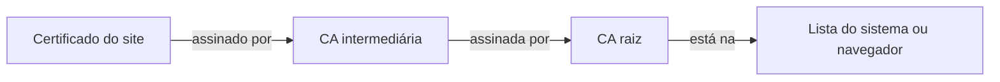

# CA

Um servidor pode dizer que é `banco.com`, e nada impede um impostor de dizer o mesmo. No [[TLS]], o navegador precisa de um terceiro em quem já confie para atestar esse nome. Esse terceiro é a CA (*certificate authority*, autoridade certificadora).

- **CA**: quem confere que o pedido vem do dono do [[Domínio|domínio]] e assina um certificado para ele.
- **Certificado do site**: documento que liga um domínio a uma chave pública, com a assinatura da CA. O servidor o entrega ao navegador a cada conexão [[TLS]].
- **Certificado da CA**: a identidade da própria CA. É ele que vai para a lista do navegador.
- **Chave privada da CA**: o que permite assinar. Fica só com a CA; quem a obtém consegue assinar certificado de qualquer site para quem confia nela.

A relação é a de um RG com o órgão que o emite: quem confere o documento confia nele porque confia no órgão.

## A lista de CAs

Sistema e navegador já vêm com uma lista de CAs raiz, as que dispensam outra assinatura. Mantêm essa lista os fabricantes, que exigem auditoria das CAs *(geral)*. O Firefox usa lista própria, e outros navegadores podem usar também *(geral)*.

A lista guarda só CAs, nunca os sites que elas assinaram: a internet tem certificados demais, e eles mudam o tempo todo. Quem traz a prova é o próprio site, ao entregar o certificado. Cada site escolhe sua CA, e todas valem igual para o navegador.

## Como o navegador confere

1. O site entrega seu certificado, em geral junto com o da CA intermediária.
2. O navegador confere as assinaturas, subindo até uma CA raiz da lista.
3. Confere se o certificado vale para aquele domínio e se está no prazo.
4. Se algo falha, mostra o aviso de conexão insegura; a página só abre se alguém mandar continuar.

A raiz assina intermediárias para a chave dela ficar guardada fora do uso diário *(geral)*.

## CA pública e CA local

| | CA pública | CA local |
|---|---|---|
| Exemplo | Let's Encrypt, DigiCert | a que o [[Reverse proxy\|Caddy]] cria |
| Assina | domínio público, depois de conferir o dono | qualquer nome, sem conferir nada |
| Já está na lista | sim, em quase todo aparelho | não: cada máquina instala uma vez |
| Serve para | site na internet | desenvolvimento, nomes como `*.localhost` |

Instalar uma CA local é somar uma linha à lista daquela máquina. Depois disso, tudo que ela assinar é aceito ali sem aviso, sem precisar registrar cada site na lista.

> [!warning] Instalar uma CA dá poder a ela
> A confiança vale para a máquina inteira, não para um site. CA instalada na mão só deve ser uma cuja chave privada esteja sob controle de quem instala.

> [!example] Exemplo
> O compose de dev usa a CA local do [[Reverse proxy|Caddy]]; na internet, o certificado vem da Let's Encrypt ([[Infra — deploy e operação]]).
