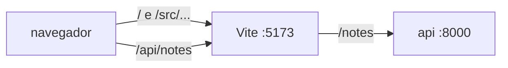

# Proxy de desenvolvimento

No desenvolvimento, o front e a api rodam em dois programas, cada um na sua [[Porta|porta]]: o servidor do front (Vite, `:5173`) e a api (`:8000`). Porta diferente é origem diferente, e o navegador barra a página de ler a api ([[CORS]]).

O proxy de desenvolvimento é uma função do próprio servidor do front: os pedidos de um prefixo (`/api`) ele não responde, repassa à api e devolve a resposta. Para o navegador, tudo vem de `:5173`.



O front pede só o caminho (`/api/notes`), uma [[URL relativa]]: o navegador completa com a origem da página, `http://localhost:5173`. O Vite vê que começa com `/api`, tira o prefixo e pede `http://localhost:8000/notes`.

## Por que não chamar a api direto?

O front poderia fazer `fetch('http://localhost:8000/notes')`. Aparecem dois problemas:

| Problema | Por quê |
|---|---|
| [[CORS]] | `:5173` e `:8000` são origens diferentes; a resposta só chega ao código se a api liberar com cabeçalho |
| endereço no código | em produção, `localhost` é a máquina de quem abriu a página, não o servidor; a URL teria de mudar por ambiente |

Com o proxy, os dois somem: o caminho relativo serve em qualquer lugar, e tudo fica na mesma origem. O outro jeito (liberar [[CORS]] na api e ler a URL de uma variável de ambiente) está na tabela "Dois jeitos de resolver" do [[CORS]].

## Precisa de um serviço à parte?

Não. O Vite (e o webpack-dev-server, o Next, o Angular CLI) já trazem o proxy: é uma configuração no arquivo dele, e ele roda no mesmo processo que serve o front.

| | Proxy de desenvolvimento | [[Reverse proxy]] (Caddy, nginx) |
|---|---|---|
| Onde roda | dentro do servidor do front | programa próprio, na frente de todos |
| Quando | só no desenvolvimento | em produção |
| Quem serve o front | o próprio Vite, com reload | o build pronto (arquivos estáticos) |
| [[TLS\|HTTPS]] | não precisa (`localhost`) | sim, com certificado |
| Configuração | `server.proxy` no `vite.config.ts` | `Caddyfile`, `nginx.conf` |

Em tipo é o mesmo: os dois ficam do lado do servidor e repassam pelo caminho, ou seja, são reverse proxies. Muda o tamanho. Em produção o Vite não existe mais (sobra o build), e a mesma divisão por `/api` passa para o reverse proxy.

Daria para rodar o Caddy também no desenvolvimento, na frente do Vite e da api. Isso deixa o desenvolvimento mais parecido com a produção, mas põe mais uma peça para subir e configurar só para fazer o que o Vite já faz.

## Configuração no Vite

```ts
server: {
  proxy: {
    '/api': {
      target: 'http://localhost:8000',
      rewrite: (path) => path.replace(/^\/api/, ''),
    },
  },
},
```

- `'/api'`: o prefixo que vai para a api. O resto (`/`, `/src/...`) o Vite responde.
- `target`: para onde repassar, visto **de onde o Vite roda**.
- `rewrite`: tira o prefixo. A api recebe `/notes`, não `/api/notes`.

> [!warning] Erros comuns
> - Vite num [[Container|container]]: `localhost` é o próprio container. O alvo é o nome do serviço na [[Rede de containers|rede do compose]] (`http://notes:8000`).
> - Esquecer o `rewrite` quando a api não tem o prefixo: tudo volta 404.
> - O proxy só existe no `vite dev`. O build (`vite build`) não leva configuração de proxy; em produção quem divide `/api` é o reverse proxy.

> [!example] No NoteProject
> O proxy do Vite repassava `/api/notes` ao serviço `notes` até o [[Reverse proxy|Caddy]] entrar na frente do compose de dev ([[Infra — deploy e operação]]).

Docs: [Vite — server.proxy](https://vite.dev/config/server-options#server-proxy).
