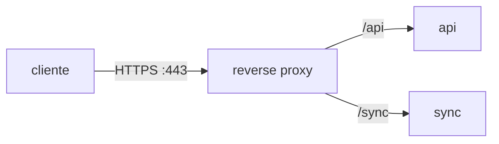
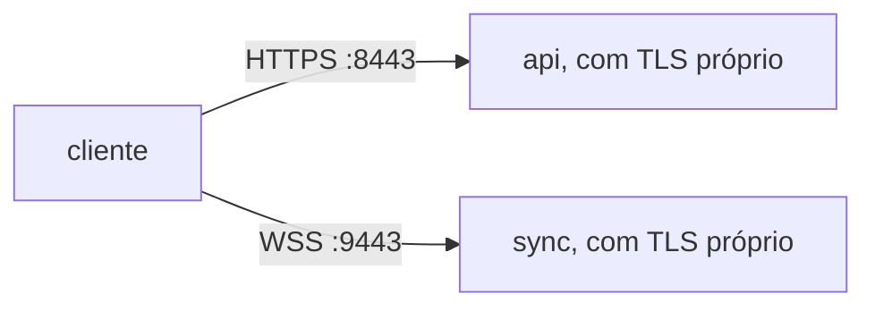

# Reverse proxy

Um servidor com vários serviços (uma api HTTP, um sync por [[WebSocket]]) tem cada um numa porta. Abrir todas para a internet espalha a segurança e o [[TLS|HTTPS]] por todos eles.

Reverse proxy é um programa na frente de todos: recebe tudo numa porta só (443) e repassa cada pedido ao serviço certo, pelo caminho.

## Contexto: por onde o pedido passa

- O [[DNS]] troca o nome pelo IP público da máquina.
- O firewall ([[Security Group]], na nuvem) deixa entrar só as [[Porta|portas]] liberadas; aqui, só a 443.
- Na máquina, o reverse proxy é o único programa escutando na 443. Os serviços escutam em outras portas, que não estão abertas para fora.
- Com [[Container|containers]], o proxy acha cada serviço pelo nome, na [[Rede de containers|rede do compose]] (`api:8000`).



- Ele cuida do [[TLS]]: os serviços atrás falam HTTP simples, dentro da máquina.
- Servidores de desenvolvimento como o Vite têm um [[Proxy de desenvolvimento|proxy parecido]], para o front chamar a api pela mesma origem.

## Sem reverse proxy

Há dois jeitos de passar sem ele.

**1. Cada serviço na sua porta, aberta para a internet**



- O cliente chama `https://site.com:8443/...` e `wss://site.com:9443/sync`.
- Cada serviço carrega o certificado e faz o [[TLS]] sozinho (no uvicorn, `--ssl-keyfile`/`--ssl-certfile`), e alguém renova o certificado e reinicia cada um.
- O firewall abre uma porta por serviço; cada uma é um lugar a mais para atacar.
- Porta diferente é **origem** diferente: o navegador passa a exigir [[CORS]] entre front, api e sync.
- Redes de empresa, hotel e universidade costumam bloquear portas fora da 80/443.

**2. Um programa só, que faz tudo na 443**

- Uma aplicação com todas as rotas (`/api` e `/sync` no mesmo FastAPI), escutando direto na 443 com TLS.
- Funciona enquanto existe **um** serviço. Separar o sync num processo à parte, ou rodar duas cópias, traz de volta a necessidade de alguém na frente repartindo.
- Perde o que o proxy dá pronto: certificado renovado sozinho, redirecionar HTTP → HTTPS, compressão, limite de tamanho de pedido, log de acesso num lugar só.
- Escutar abaixo da porta 1024 no Linux pede root ou a permissão `CAP_NET_BIND_SERVICE`.

| | Portas separadas | Um programa na 443 | Reverse proxy |
|---|---|---|---|
| Portas abertas | uma por serviço | 443 | 443 |
| Quem faz [[TLS]] e renova certificado | cada serviço | a aplicação | o proxy |
| [[CORS]] no navegador | sim | não | não |
| Serviços separados | sim | não | sim |
| Peças a mais | nenhuma | nenhuma | o proxy |

Para teste rápido ou um serviço só, ficar sem proxy é aceitável. Com dois serviços ou mais, ou um navegador como cliente, o proxy custa menos do que o que ele substitui.

## Proxy × reverse proxy

Os dois são um intermediário que recebe o pedido e repassa. Muda para quem ele trabalha.

| | Proxy (forward) | Reverse proxy |
|---|---|---|
| Fica do lado de | quem pede (cliente) | quem responde (servidor) |
| Quem configura | o cliente ou a rede dele | o dono do servidor |
| Esconde | o cliente: o site vê o IP do proxy | os serviços: o cliente vê um endereço só |
| Uso típico | proxy da empresa, filtro de sites | uma porta 443 na frente de vários serviços |

## Um pedido passando pelo reverse proxy

O cliente abre o `/sync` como um [[WebSocket]]. São **duas conexões**: cliente → proxy (com [[TLS]]) e proxy → serviço (HTTP simples, dentro da máquina).

1. O cliente resolve o [[Domínio|domínio]], abre TCP no IP do servidor, porta 443.
2. Handshake [[TLS]]: o cliente manda o nome do site (SNI), o proxy responde com o certificado daquele nome. Daqui em diante o tráfego é cifrado.
3. Dentro do TLS vai um pedido HTTP comum:
   ```http
   GET /sync HTTP/1.1
   Host: notes.exemplo.com
   Upgrade: websocket
   Connection: Upgrade
   Sec-WebSocket-Key: dGhlIHNhbXBsZSBub25jZQ==
   Sec-WebSocket-Version: 13
   ```
4. O proxy decifra, olha o caminho (`/sync`), escolhe o serviço e abre uma conexão nova com ele. O pedido segue igual, com cabeçalhos a mais que contam o que o serviço não vê:
   ```http
   GET /sync HTTP/1.1
   Host: notes.exemplo.com
   Upgrade: websocket
   Connection: Upgrade
   Sec-WebSocket-Key: dGhlIHNhbXBsZSBub25jZQ==
   Sec-WebSocket-Version: 13
   X-Forwarded-For: 203.0.113.7
   X-Forwarded-Proto: https
   X-Forwarded-Host: notes.exemplo.com
   ```
   - `X-Forwarded-For`: o IP do cliente (o serviço só vê o IP do proxy).
   - `X-Forwarded-Proto`: o cliente usou HTTPS (o serviço recebeu HTTP).
5. O serviço responde `101 Switching Protocols`; o proxy devolve ao cliente, cifrado.
6. A partir daí não há mais pedido e resposta: o proxy copia bytes nos dois sentidos enquanto a conexão durar. Numa rota HTTP comum (`/api`), o passo 5 é a resposta final e acabou.

> [!warning] Erros comuns
> - O caminho chega inteiro: o serviço recebe `/sync`, não `/`. Tirar o prefixo é configuração do proxy.
> - Serviço que confia em `X-Forwarded-For` vindo de qualquer um aceita IP falso; só vale o que o proxy escreveu.
> - Proxy com tempo limite curto derruba [[WebSocket]] parado; o sync precisa de ping.

## Vários sites e várias rotas

Um proxy só, numa [[Porta|porta]] só, atende vários nomes e vários serviços. Quem leva o pedido até ele é o IP e a porta ([[DNS]], firewall, porta publicada); vários nomes podem dar o mesmo IP. Lá dentro, ele decide em dois passos:

| Passo | Olha | Onde está no pedido | Escolhe |
|---|---|---|---|
| 1. Site | o nome | SNI (no handshake [[TLS]]) e o cabeçalho `Host` | o certificado e o bloco de rotas daquele nome |
| 2. Rota | o caminho | a linha `GET /api/notas` | o serviço |

No Caddy, um site com três rotas:

```
notas.exemplo.com {
    handle_path /api/* {
        reverse_proxy api:8000
    }

    handle_path /ia/* {
        reverse_proxy ia:9000
    }

    handle {
        reverse_proxy front:5173
    }
}
```

- `handle_path` tira o prefixo antes de repassar (`/api/notas` → `/notas`); `handle /api/*` repassaria o caminho inteiro.
- O `handle` sem caminho é o "senão": pega o que nenhum outro pegou. Só um `handle` roda por pedido, e os que têm caminho são testados antes do que não tem, seja qual for a ordem no arquivo *(geral)*.
- Serviço novo = prefixo novo; o "senão" continua pegando só o resto.
- `api:8000`: o nome acha a máquina (o [[Container|container]]), a porta acha o programa nela. Sem porta, o Caddy tenta a 80 *(geral)*.

> [!warning] Erros comuns nas rotas
> - Prefixos que se cruzam (`/api/*` e `/api/ia/*`): o Caddy fica com o caminho mais longo *(geral)*, mas a regra fica escondida; prefixos separados evitam a dúvida.
> - Página do front com o mesmo prefixo de um serviço (`/api/...`) vai parar no serviço.
> - Serviço que o navegador nunca chama (um worker que só fala com o banco) não precisa de rota.

## Programas de reverse proxy

| | Caddy | nginx | Traefik | HAProxy | ALB (AWS) |
|---|---|---|---|---|---|
| O que é | servidor web em Go, um binário | servidor web em C, o mais usado | proxy feito para containers | balanceador de carga | balanceador gerenciado |
| Configuração | `Caddyfile` curto | arquivo longo, explícito | *labels* nos [[Container\|containers]] | arquivo explícito | console ou [[Terraform]] |
| Certificado [[TLS\|HTTPS]] | pede e renova sozinho (Let's Encrypt; CA local em `localhost`) | à parte (certbot) | sozinho, depois de configurar | à parte | ACM, sozinho |
| [[WebSocket]] | sem configuração extra | precisa repassar `Upgrade`/`Connection` à mão | sem configuração extra | sem configuração extra | sem configuração extra |
| Rotas novas | editar e recarregar | editar e recarregar | aparecem quando o container sobe | editar e recarregar | regra nova no ALB |
| Forte em | pouco trabalho, poucos serviços fixos | desempenho, material na internet, arquivos estáticos | muitos containers que sobem e descem | TCP e balanceamento fino, alta carga | várias máquinas, sem servidor para cuidar |
| Custo | grátis | grátis | grátis | grátis | por hora + tráfego |

### Como escolher

- **Uma máquina, 2–5 serviços fixos** → Caddy: menos linhas e o certificado se resolve sozinho.
- **Já há experiência ou config pronta de nginx**, ou muito arquivo estático → nginx.
- **Dezenas de containers criados e destruídos** (Docker Swarm, Kubernetes) → Traefik, que lê as rotas dos próprios containers.
- **Tráfego alto, balanceamento por TCP, regras finas de saúde** → HAProxy.
- **Mais de uma máquina na AWS**, sem querer cuidar do proxy → ALB (com certificado do ACM).

Os cinco fazem o básico (TLS na 443, rota por caminho, WebSocket). A escolha pesa trabalho de configuração e onde o resto da infra está.

> [!example] No NoteProject
> Caddy na frente da api e do sync ([[Infra — deploy e operação]]).

Docs: [Caddy reverse_proxy](https://caddyserver.com/docs/caddyfile/directives/reverse_proxy), [Caddy handle](https://caddyserver.com/docs/caddyfile/directives/handle), [Caddy handle_path](https://caddyserver.com/docs/caddyfile/directives/handle_path), [Caddy Automatic HTTPS](https://caddyserver.com/docs/automatic-https), [nginx WebSocket proxying](https://nginx.org/en/docs/http/websocket.html), [Traefik Docker provider](https://doc.traefik.io/traefik/providers/docker/), [RFC 6455 (WebSocket)](https://www.rfc-editor.org/rfc/rfc6455).
