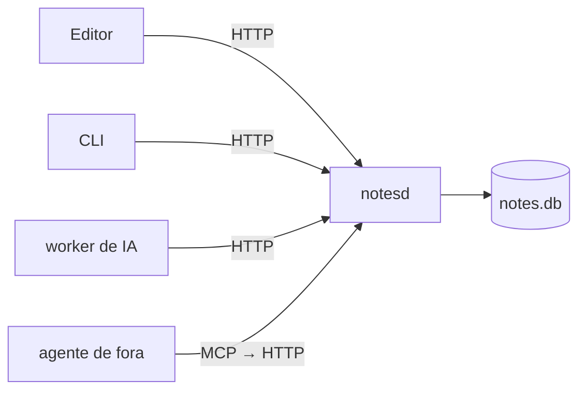

# O daemon notesd

Desenho do daemon do **app desktop** (milestone Desktop app, depois do [[Navegador|navegador]]; ordem no [[Roadmap]]).

O app desktop precisa salvar as notas no disco, para funcionar offline. O `notesd` vai ser o [[Daemon|daemon]] dono do [[SQLite]] local: o único processo que mexe no banco. Editor, CLI, o worker de IA e agentes de fora pedem a ele por HTTP.

- É ele que deixa o app desktop [[Local-first|local-first]]: a tecla grava aqui, sem passar pela rede.
- Por que um dono só: [[Daemon]].

## Camadas (⏳)

Pasta planejada: `apps/notesd/notesd/`.

| Arquivo | Papel |
|---|---|
| `__main__.py` | `python -m notesd` sobe o uvicorn em `127.0.0.1:8787` (`NOTESD_HOST`, `NOTESD_PORT`) |
| `config.py` | caminho do banco: `NOTESD_DB` ou `~/.local/share/notesd/notes.db` |
| `db.py` | abre o [[SQLite]] em WAL (leitura e escrita juntas) e aplica o `schema.sql`; `transaction()` faz commit ou rollback |
| `schema.sql` | tabela `notes` + índice [[FTS5]] |
| `models.py` | formatos Pydantic que cruzam o HTTP; título derivado do texto |
| `repo.py` | todo o SQL; as rotas nunca escrevem query |
| `app.py` | rotas finas; CORS só para localhost e Tauri |

## Modelo de dados (⏳)

- O mesmo do servidor ([[Pastas, campos e views]]): pasta é nota com `is_folder = 1`; a árvore vem de `parent_id`, e apagar a pasta apaga os filhos (`ON DELETE CASCADE`).
- `fields`: JSON com os campos da nota. Datas em milissegundos.
- Título: primeiro heading, senão a primeira linha com texto.
- Id: UUIDv7, que pode vir do cliente. O id local já é o final, e o sync não precisa de tabela traduzindo id local em id remoto.

## Rotas (⏳)

O mesmo contrato do servidor, que o cliente da API do front vai chamar: o editor não muda.

| Rota | Faz |
|---|---|
| `GET /health` | responde `ok` |
| `POST /notes` | cria; 409 se o id já existe ou o pai não existe |
| `GET/PATCH/DELETE /notes/{id}` | lê, salva, apaga; 404 se não existe |
| `GET /notes?parent_id=` | filhos diretos de uma pasta, pastas primeiro |
| `GET /notes/recent` | as últimas editadas, sem o conteúdo, ignorando a árvore |
| `GET /search?q=` | busca [[FTS5]] com trecho marcado por `<mark>` |

## Busca (⏳)

- `notes_fts` *external content*, mantido por três gatilhos.
- Cada palavra entre aspas, como prefixo: um `-` ou `*` digitado não vira sintaxe.
- Acento ignorado: "funcao" acha "função" (`remove_diacritics 2`).

## Cuidados no desenho

- `PATCH` precisa distinguir "não mudar o pai" de "mover para a raiz" (`parent_id: null`).
- Uma conexão só com `check_same_thread=False` não protege duas escritas ao mesmo tempo: usar uma conexão por requisição ou uma fila de escrita.
- Registrar o que mudou, para o [[Sync por versão|sync]] depois de offline.

## Depois (⏳)

- CLI como mais um cliente (Neovim só como ideia, em [[Features]]).
- O par do outro lado da rede é o servidor de sync: [[Back — daemon e servidor]].
- A IA do app roda num worker que pega os pedidos da [[Fila de pedidos|fila]] e lê o [[Workspace no app|workspace]]; agente de fora, como o Claude Code, entra por [[MCP]] ([[MCP — a IA como cliente do daemon]]).
- No sync, guarda o [[Token por dispositivo|token]] do dispositivo e fala com o servidor; o front nunca fala direto com ele.
