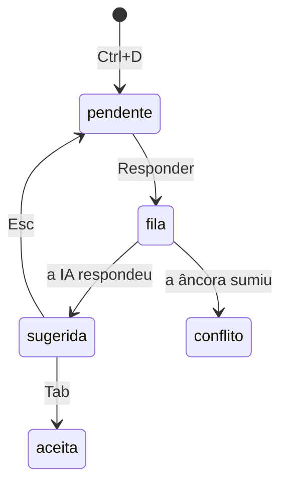

# Fila de pedidos

Com [[Marcar dúvida]], marcar ficou rápido. Falta pedir a resposta sem ir ao terminal.

A fila junta as duas coisas no editor e deixa você decidir **quando** gastar tokens.

## Estados de um pedido

## Três jeitos de pedir

| Jeito | Quando | Custo |
|---|---|---|
| chip → `Responder` | quer a resposta agora | uma chamada por dúvida |
| `Responder todas` (da nota ou da matéria) | fim da sessão de estudo | uma chamada por lote; regras e card entram uma vez |
| `/duvida` no Claude Code, via [[MCP — a IA como cliente do daemon\|MCP]] | quer conversar (`/destrinchar`) | sessão interativa |

O jeito recomendado é o segundo: marcar durante o estudo e responder em lote no fim.

## Quem responde

Um *worker* pega os pedidos da fila e chama o provedor configurado ([[Sem Claude Code — provedores]]). No [[Navegador]], o worker roda no servidor; no app desktop, no [[O daemon notesd|daemon]].

- A fila sincroniza entre aparelhos: o pedido feito no celular pode ser respondido pelo PC.
- Cada pedido declara do que precisa (`precisa: [python, modelo-local]`); só pega o pedido um worker que tenha isso.

O pedido sai com o contexto já montado pelo worker, a partir do [[Workspace no app|workspace]]:

- a pergunta e o trecho selecionado;
- a seção em volta (do heading anterior ao próximo), não a nota inteira;
- o card do tema, achado por [[Classificar a nota pelo tema|`fields.conteudo`]];
- a lista de [[Blocos padronizados|moldes]] que a resposta pode usar.

A resposta volta como [[Edição por âncora|operação]] e aparece como sugestão no lugar da dúvida. A pergunta vai para a lista `## Dúvidas` no fim da nota, como a regra de página de 2026-10-10 pede.

## Por que assim

- A IA não procura nada: não lê arquivo nem faz `grep`. Numa sessão agêntica, cada passo de busca é mais uma chamada com o contexto inteiro. Aqui é uma chamada só, com o contexto pronto.
- No lote, o começo da chamada (regras + card) é igual para todas as dúvidas e é reaproveitado pelo [[Cache de prompt|cache]] ([[Gastar poucos tokens]]).
