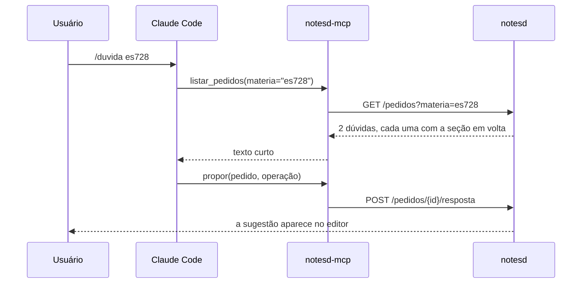

# MCP — a IA como cliente do daemon

Hoje a IA lê e escreve arquivos `.md`. Um timer copia vault ↔ repo a cada 5 min e avisa quando há conflito.

Se as notas passam a morar no [[O daemon notesd|notesd]], a IA precisa de outro jeito de chegar nelas. O [[MCP]] dá à IA **funções** prontas (buscar, ler uma seção, propor uma edição) em vez de deixá-la abrir arquivos.

Aqui o cliente [[MCP]] é o Claude Code, e o servidor é um módulo do daemon. É um caminho para a primeira versão e para quem já usa um agente de fora; o caminho principal é a IA dentro do app, com o [[Workspace no app|workspace]] de cada pessoa e sem terminal.

## Como ficaria



- `notesd-mcp` seria um módulo do próprio `apps/notesd` (`python -m notesd.mcp`), feito com o SDK `mcp` de Python.
- Ele **não** abre o [[SQLite]]: chama o [[O daemon notesd|daemon]] por HTTP. O [[O daemon notesd|daemon]] continua sendo o dono único.
- No repo onde a IA roda, um `.mcp.json` diz ao Claude Code como iniciar o servidor:

```json
{
  "mcpServers": {
    "notas": {
      "command": "uv",
      "args": ["run", "--directory", "/caminho/do/NoteProject/apps/notesd",
               "python", "-m", "notesd.mcp"]
    }
  }
}
```

## Poucas ferramentas

O nome, a descrição e os parâmetros de cada ferramenta entram no contexto da sessão. Por isso, poucas e curtas:

| Ferramenta | Devolve |
|---|---|
| `buscar(q, materia?)` | títulos + a linha que bateu ([[FTS5]]), não a nota |
| `ler_secao(nota, heading)` | só a seção pedida |
| `listar_pedidos(materia?)` | dúvidas e fix pendentes, cada um com a seção em volta |
| `propor(pedido, operacao)` | grava uma [[Edição por âncora\|operação]], que você aceita no editor |

## Por que, comparado com os arquivos de hoje

| Hoje | Com [[MCP]] |
|---|---|
| `grep` + leitura do arquivo para achar uma dúvida | `listar_pedidos` já devolve a dúvida e a seção |
| timer de 5 min e conflito vault ↔ repo | uma cópia só, ao vivo |
| a IA escreve direto no arquivo | a IA propõe e você aceita |
| só quem conhece a estrutura de pastas acha as coisas | qualquer cliente [[MCP]] usa as mesmas funções |

O [[MCP]] serve para quando você **está** numa sessão (`/duvida`, `/destrinchar`). Para responder sem abrir o terminal, ver [[Fila de pedidos]].
